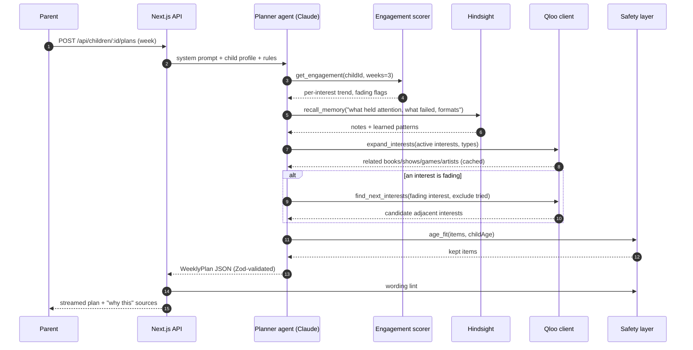
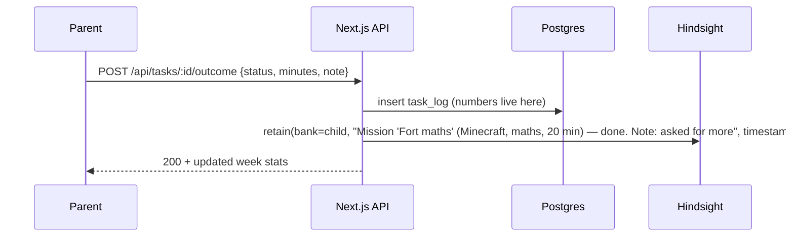

# SparkPath — Architecture

As of 2026-10-16. Why each choice was made (and what was rejected) lives in [DECISIONS.md](DECISIONS.md); IDs like **D-03** point there.

## 1. System at a glance

One Next.js app on Vercel serves the adult-only UI and the API. A Claude tool-use agent in the backend calls Qloo (taste), Hindsight (memory) and our own Postgres (profiles, logs, numeric engagement).

```mermaid
flowchart LR
  subgraph Client["Browser (adults only)"]
    P[Parent views]
    T[Teacher views]
  end

  subgraph Vercel["Next.js app on Vercel (D-02)"]
    UI[React Server Components + client islands]
    API[Route handlers / server actions]
    AG[Planner agent<br/>Claude tool use (D-04)]
    SC[Engagement scorer<br/>pure TypeScript (D-08)]
    QC[Qloo client + cache]
    SF[Safety layer<br/>age-fit + wording lint (D-11)]
  end

  DB[(Postgres<br/>Neon (D-06))]
  HS[(Hindsight memory<br/>one bank per child (D-07))]
  QL[[Qloo Insights API<br/>hackathon.api.qloo.com]]
  CL[[Claude API]]

  P --> UI
  T --> UI
  UI --> API
  API --> AG
  AG -->|tools| QC
  AG -->|tools| SC
  AG -->|tools| HS
  AG --> CL
  AG --> SF
  QC --> QL
  QC <--> DB
  SC --> DB
  API --> DB
  API --> HS
```

## 2. Components

| Component | Responsibility | Tech |
| --- | --- | --- |
| Web UI | Parent + teacher screens, demo mode, compare view | Next.js App Router, React, Tailwind, shadcn/ui (D-02, D-12) |
| API layer | Auth/demo session, CRUD, plan generation endpoint (streamed), logging | Next.js route handlers + server actions |
| Planner agent | Decides which tools to call, assembles the weekly plan | Anthropic SDK tool runner, `claude-sonnet-5-5` (D-04, D-05) |
| Qloo client | `/search`, `/v2/tags`, `/v2/insights`; normalises + trims verbose fields; caches | TypeScript `fetch`, Postgres cache table (D-09) |
| Engagement scorer | Weekly minutes/completions per interest; fading flag | Pure TS functions, unit-tested (D-08) |
| Memory service | Wraps Hindsight: retain outcomes/notes, recall patterns, reflect | `@vectorize-io/hindsight-client` (D-07) |
| Safety layer | Age-fit scoring of Qloo items, banned-word lint on all generated text, schema validation | `claude-haiku-5-5` + Zod + regex lint (D-11) |
| Postgres | Adults, children, consent, interests, plans, tasks, logs, Qloo cache | Neon serverless Postgres + Drizzle ORM (D-06) |

## 3. Request flows

### 3.1 Generate weekly plan (the core loop)



### 3.2 Log an outcome



Numbers go to Postgres so the fading percentage is exact and reproducible; words go to Hindsight so the agent can recall meaning ("short missions beat long reading"). See D-08.

### 3.3 Compare view (AI alone vs SparkPath)

Two calls in parallel for the same child and request:

1. **AI alone:** Claude, same model, given only the child's interest names. No tools.
2. **SparkPath:** full agent run (3.1), served from cache in demo mode.

Rendered side by side, each SparkPath item labelled with its Qloo source entity.

### 3.4 Teacher lesson hooks

Server action `generateHooksAction(classId, {topic, minutes})` → `lib/hooks/generate.ts`. A workflow, not an agent (D-22):

1. For each child in the class (in parallel): pick the main interest (not a fading one), read engagement formats, recall up to 3 adult notes, and get up to 6 age-fit Qloo picks (games, shows, books) for that interest.
2. One `messages.parse` call with a Zod output schema writes all hooks (title, opener, first activity, optional `qlooEntityId`).
3. Grounding per child: a cited entity must be in **that child's** picks, otherwise it's dropped. A hook with banned wording falls back to the offline template for that child.
4. Saved as a row in `lessons` (`hooks` JSON). Teachers edit hooks inline; edits go through the same wording lint.

Without a Claude key, or on failure, offline templates write the hooks from the same context.

## 4. Agent tools

| Tool | Input | Output | Backed by |
| --- | --- | --- | --- |
| `get_child_profile` | — | nickname, age, interests with status and start date | Postgres |
| `get_engagement` | — | per-interest weekly minutes, % change, state (fading / holding / dipping / trial), formats that work / to avoid | Engagement scorer |
| `recall_memory` | query | ranked memory snippets | Hindsight `recall` (or local fallback) |
| `resolve_interest` | name | Qloo entity matches | Qloo `/search` |
| `expand_interests` | interest labels, types, take | related entities per type, age-filtered, excluding tried items | Qloo `/v2/insights` |
| `find_next_interests` | — (reads engagement) | up to 3 candidates: taste tag, bridged interests, example entities | Qloo `/v2/insights` (entities + `urn:tag` audience tags) |

Age-fit filtering runs **inside** the Qloo tools rather than as a tool the model calls, so the model never sees unsuitable items. Every entity a Qloo tool returns is recorded for the run; the plan validator rejects any reference outside that set.

The agent ends by calling no tool and returning `WeeklyPlan` JSON (schema in [DESIGN.md](DESIGN.md) §3), which is validated (schema, grounding, wording lint); a failure gets one repair turn with the errors listed. Limits: 12 tool calls per run (reserved before each parallel batch), 45 s deadline (so the offline fallback still fits Vercel's 60 s), `effort: medium`. Server-side refusal fallback (`fallbacks: "default"`) is on; set `PLANNER_FALLBACKS=off` where unsupported. Code: `lib/agent/`.

## 5. Qloo integration detail

- Base URL from env `QLOO_BASE_URL=https://hackathon.api.qloo.com`; key in `QLOO_API_KEY`, sent as `X-Api-Key`. Server-side only.
- Every call is `GET`; params in the query string.
- Cache key = `sha256(path + sorted query)`; stored in `qloo_cache` (Postgres) with no expiry for the hackathon (allowed by Qloo); never written to the repo.
- Response trimming: keep `entity_id`, `name`, `types`, `properties.image`, `properties.short_description`, `properties.release_year`/`publication_year`, `tags` (names), `popularity`; drop `akas` and other verbose fields.
- Guard against silent param ignoring: a startup self-test checks one known request per type returns non-empty `entities`.

## 6. Hindsight integration detail

- One bank per child: `bank_id = child_<uuid>` (isolation and one-call deletion; D-07).
- Bank mission: "Track what keeps this child engaged: interests, task formats, times, and what caused frustration. Never infer or label medical conditions."
- `retain` on every outcome log and every free-text adult note, with `timestamp` = event time and `context` = `"task_outcome"` / `"adult_note"`.
- `recall` in the agent's `recall_memory` tool; `reflect` for the weekly insight's one-paragraph summary.
- Deletion: "Forget this child" deletes the bank and all Postgres rows.

## 7. Deployment

| Piece | Where | Notes |
| --- | --- | --- |
| Web + API | Vercel (Hobby/Pro) | Node runtime for agent routes (`maxDuration` 60 s) |
| Postgres | Neon | Branch per preview deploy |
| Hindsight | Hindsight Cloud if access allows, else Docker on Railway/Fly with its own Postgres + pgvector | Decide day 1 (D-07) |
| Secrets | Vercel env vars | `QLOO_API_KEY`, `ANTHROPIC_API_KEY`, `HINDSIGHT_URL`, `HINDSIGHT_API_KEY`, `DATABASE_URL` |

## 8. Demo mode

- The landing page's button POSTs to `/demo` (POST so link prefetching can't create demos). It creates a private parent `demo-<uuid>@demo.sparkpath.local`, seeds a fresh Arjun under it, sets a signed `sp_session` cookie (HMAC with `SESSION_SECRET`), and redirects to This week. Every page and server action checks the child belongs to the cookie's parent (`lib/session.ts`). Demos older than 24 h are deleted on the next demo start.
- "Teacher? Explore a sample class of five" POSTs to `/demo/teacher`: a private teacher ("Ms. Rao") with class 4B, Arjun (full history) plus four classmates with one interest each (`db/seed/classroom.ts`). Children are owned by the teacher's account in the demo; in a real school each parent opts in.
- This week's plan for a new demo is copied from the template Arjun's current-week plan when one exists (made by the agent at prewarm), otherwise built instantly by the offline planner (D-21), so the first screen never waits on the model.
- Arjun's Qloo results are pre-warmed into the cache at deploy time (server-side, not in git).
- Seed script inserts 3 weeks of task logs and retains matching notes into a fresh Hindsight bank.

## 9. Security and privacy

- Adult accounts only (email magic link via Auth.js); children have no login.
- Consent checkbox and timestamp stored per child before any data is saved.
- Minimal fields: nickname, age (years), interests, logs, notes. No photo, school, location or condition field.
- All third-party calls server-side; no keys in the browser.
- Data deletion: one action per child (Postgres cascade + Hindsight bank delete).
- Logs never include notes text.

## 9b. Offline planner

`lib/plan/fallback.ts` builds a valid, grounded `WeeklyPlan` from the same tools the agent uses, with fixed mission templates instead of Claude. It is used when Claude isn't configured, when the agent fails (one notice line in the UI), and for instant demo plans. The UI labels such plans "Quick plan (made without the AI planner)". See D-21.

## 10. Local development and fallbacks

Each external dependency has a local stand-in, chosen by environment variables, so the app and tests run with no keys:

| Dependency | Configured by | Fallback when unset |
| --- | --- | --- |
| Postgres | `DATABASE_URL` | Embedded PGlite in `.data/pglite` (git-ignored) |
| Hindsight | `HINDSIGHT_URL` (+ `HINDSIGHT_API_KEY`) | `memory_notes` table with keyword + recency recall; no `reflect` |
| Qloo | `QLOO_API_KEY` / `QLOO_MODE` | `lib/qloo/mock.ts`: hand-written catalog, all ids prefixed `mock:` (not Qloo data) |

In dev, the database handle lives on `globalThis`: Next can load a module more than once (hot reload, separate route bundles), and two PGlite instances on one folder don't see each other's writes.

The Qloo cache stores the raw response body keyed by request hash; trimming happens on read.

## 11. Repository layout

```
/app                Next.js routes (parent, teacher, demo, api)
/components         UI components
/lib/agent          agent loop, tools, prompts
/lib/qloo           client, types, trimming, cache
/lib/memory         Hindsight wrapper + local fallback, outcome → memory sentences
/lib/engagement     scorer (pure, tested)
/lib/safety         age-fit, wording lint, schemas
/db                 Drizzle schema, migrations, seed persona (no Qloo data)
/scripts            qloo-coverage-test.ts, seed.ts
/docs               these docs
LICENSE             MIT
```
