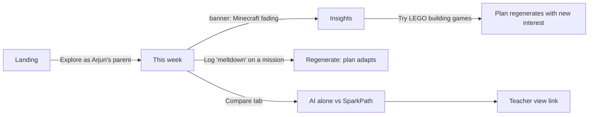

# SparkPath — UI / UX Spec

As of 2026-10-16. What the adult sees and does, screen by screen. Build against this before writing UI code. Data shapes come from [DESIGN.md](DESIGN.md); reasons from [DECISIONS.md](DECISIONS.md).

## 1. Who we design for

| Persona | Context of use | What they need from us |
| --- | --- | --- |
| **Priya, parent of Arjun (9)** | Phone, evenings and Sunday night, often tired; may have ADHD traits herself | "Tell me what to do this week" in under 2 minutes; logging that takes seconds; no guilt, no jargon |
| **Ms. Rao, Grade 4 teacher / learning-support educator** | Laptop, planning period, 25 kids, a few need extra hooks | One lesson → a hook per child, printable, in under 5 minutes |
| **Hackathon judge** | Desktop, first visit, 3–5 minutes, no signup | See the "AI alone vs SparkPath" difference and the fading-interest insight fast |

## 2. Design principles

1. **One next action per screen.** Every screen has a single primary button. Tired adults shouldn't choose between five things.
2. **Interests are the colour of the product.** Each interest gets a stable colour and icon; missions, books and insights carry it, so the plan reads at a glance.
3. **Show the why.** Every recommendation has a "Why this?" that names the Qloo source ("Fans of Minecraft and cricket also love…") and any memory used ("Short missions worked last week").
4. **Logging in one tap.** Outcome = one tap; minutes and notes are optional, one more tap.
5. **Warm, calm, never clinical.** No medical words (lint list in DESIGN §8), no red alarm states for a child's behaviour. A "meltdown" log is neutral, not an error.
6. **Adult-first, child-safe.** Nothing is addressed to the child except the printable mission card, which the adult chooses to share.
7. **Mobile-first for parents, wide for teachers.**

## 3. Information architecture

```
/                        Landing (pitch, "Explore the demo", "Sign in")
/demo                    Starts demo as Priya → /app/child/arjun
/app                     Parent home: children list (or straight to the only child)
/app/child/:id           This week (plan)            ← default tab
/app/child/:id/insights  Insights (engagement + next interests)
/app/child/:id/interests Interests (add, pause, see status)
/app/child/:id/compare   AI alone vs SparkPath
/app/child/:id/history   Past weeks
/app/settings            Account, consent records, delete data
/teach                   Teacher home: classes
/teach/class/:id         Class roster + lesson hooks
/onboarding              Add a child (consent → basics → interests)
```

Parent navigation: bottom tab bar on mobile (**This week · Insights · Interests · More**); left sidebar on desktop. Teacher: top bar + left class list.

## 4. Key flows

### 4.1 Judge / demo flow (must work in 3 minutes)



A dismissible **guided tour** (4 steps, coach marks) runs on first demo load: 1) the fading banner, 2) a mission's "Why this?", 3) the compare tab, 4) the teacher view. Skippable; never blocks.

### 4.2 Parent onboarding (real users)

1. **Consent** — "You're the parent or guardian, and you agree to SparkPath storing your child's nickname, age, interests and your notes." Checkbox + "Continue". Link to what we store and how to delete it.
2. **Basics** — nickname (not full name), age (stepper 5–13).
3. **Interests** — type-ahead backed by Qloo search; chips with type badge (Game, Show, Book, Sport/Topic). Minimum 1, suggest 2–4. "Also hates…" optional field (e.g. long reading).
4. **What do you want help with?** — multi-select: homework (maths/reading/writing), chores, morning routine, bedtime routine, screen-free time.
5. **Generate first week** → streamed plan screen.

### 4.3 Weekly loop

Sunday: open app → "Plan next week" → review → swap any mission ("Swap" gives 2 alternatives) → "Looks good" → share/print cards.
During week: tap a mission → outcome sheet → done.
Next Sunday: insights card at top of the new plan.

### 4.4 Teacher flow

Class → "New lesson hook" → topic (e.g. "Fractions") + duration → generate → grid of child cards, each with a hook and the interest it uses → edit inline → print all / export PDF.

## 5. Screens (wireframes)

### 5.1 Landing

```
┌──────────────────────────────────────────────┐
│ SparkPath                         Sign in    │
│                                              │
│  Homework they actually want to do.          │
│  SparkPath turns your child's obsessions     │
│  into missions, books and routines — and     │
│  spots the next obsession before boredom.    │
│                                              │
│  [ Explore as Arjun's parent → ]  (primary)  │
│    No signup. 3-minute tour.                 │
│                                              │
│  How it works: Interests → Taste graph →     │
│  Weekly plan → What worked → Next interest   │
│                                              │
│  For teachers →        Powered by Qloo       │
└──────────────────────────────────────────────┘
```

### 5.2 This week (parent, mobile)

```
┌─────────────────────────────┐
│ Arjun · Week of 19 Oct   ▾  │
├─────────────────────────────┤
│ ⚡ Minecraft is fading       │
│ Down 41% vs last 2 weeks.   │
│ 3 new interests to try →    │  ← insight banner (amber, not red)
├─────────────────────────────┤
│ Cricket week, with a dash   │
│ of LEGO building            │  ← headline
│                             │
│ MISSIONS  5                 │
│ ┌─────────────────────────┐ │
│ │▌🏏 Stadium maths        │ │  ← colour bar = interest
│ │  Maths · 15 min · Build │ │
│ │  [Done] [Partial] [Skip]│ │  ← inline quick log
│ │  Why this?              │ │
│ └─────────────────────────┘ │
│ ┌─────────────────────────┐ │
│ │▌🧱 Brick-by-brick chore │ │
│ │  Chore · 10 min         │ │
│ └─────────────────────────┘ │
│                             │
│ READING  (short + comics)   │
│ [cover][cover][cover] →     │
│                             │
│ FOCUS PLAYLIST  6 tracks    │
│ WEEKEND  Backyard test match│
├─────────────────────────────┤
│ This week Insights Interests More │
└─────────────────────────────┘
```

Mission detail (bottom sheet): title, steps (large, numbered, read-aloud friendly), est. minutes, "Why this?" (Qloo refs + memory), **Print card**, **Swap**, outcome buttons incl. **Meltdown** and optional minutes chips + note.

### 5.3 Outcome sheet

```
How did "Stadium maths" go?
[ Done ] [ Partial ] [ Skipped ] [ Hard moment ]
Time on it:  5  10  15  20  30+
Note (optional): _______________________
              [ Save ]
```

"Hard moment" is the UI label for the `meltdown` status — neutral, non-judgemental. Saved toast: "Got it. Next week's plan will use this."

### 5.4 Insights

```
┌────────────────────────────────────────┐
│ Last 3 weeks                           │
│ Minutes engaged by interest (line)     │
│  Minecraft  125 → 80 → 60   ↓ 41%      │
│  Cricket     75 → 75 → 80   holding    │
│                                        │
│ What works for Arjun                   │
│  ✓ Short missions (≤15 min) 90% done   │
│  ✗ Long reading — skipped 2 of 2       │
│  "Said Minecraft is boring now" — Thu  │
│                                        │
│ Try next (fans of Minecraft + cricket) │
│ ┌──────────┐┌──────────┐┌──────────┐   │
│ │LEGO build││ …        ││ …        │   │
│ │bridge    ││          ││          │   │
│ │starter   ││          ││          │   │
│ │[Try it]  ││[Try it]  ││[Try it]  │   │
│ └──────────┘└──────────┘└──────────┘   │
└────────────────────────────────────────┘
```

"Try it" adds the interest as `trial` and offers "Regenerate this week with it".
Chart: one line per interest in its interest colour; the fading one emphasised, others muted. Numbers labelled directly at line ends (no legend hunt).

### 5.5 Compare (AI alone vs SparkPath)

Two columns, same request at the top ("Help Arjun, 9, who loves Minecraft and cricket, read more").

| AI alone | SparkPath |
| --- | --- |
| Generic bullet list ("try graphic novels") | Named books/shows/games, each with a "From Qloo: fans of X also like" chip |
| No history | Uses memory: "short formats work", "Minecraft fading" |
| — | Next-interest suggestions |

A small footer: "Same model, same request. The only difference is Qloo's taste graph and Arjun's memory." On mobile the columns become tabs.

### 5.6 Interests

List of chips with status pills: **Active**, **Fading**, **Trial**, **Paused**. Add via Qloo type-ahead. Pause/resume per interest. Each shows a small 3-week sparkline.

### 5.7 Teacher class view (desktop)

```
┌─ Classes ─┬──────────────────────────────────────────────┐
│ 4B        │ Lesson: Fractions · 40 min   [Generate hooks]│
│ 4C        │ ┌────────┐┌────────┐┌────────┐┌────────┐┌───┐│
│           │ │Arjun   ││Meera   ││Kabir   ││Zoya    ││...││
│           │ │🏏 Split││🦕 Dino ││⚽ Pass ││🚀 Fuel ││   ││
│           │ │the over││ dig    ││ map    ││ tanks  ││   ││
│           │ │ [edit] ││ [edit] ││ [edit] ││ [edit] ││   ││
│           │ └────────┘└────────┘└────────┘└────────┘└───┘│
│           │                 [Print all]  [Export PDF]    │
└───────────┴──────────────────────────────────────────────┘
```

### 5.8 Printable mission card (the only child-facing artefact)

A6 card: interest icon, big title, 2–5 numbered steps with checkboxes, a "Mission complete!" stamp box. No AI chat, no links, no child name required.

## 6. States

| State | Treatment |
| --- | --- |
| Plan generating | Streamed: headline first, then missions appear one by one; progress line "Checking what worked… Finding books fans love… Writing missions…" (maps to real tool calls) |
| Empty (new child) | "No history yet — we'll learn from this week." Insights tab shows what will appear after 2 weeks |
| Low Qloo data for an interest | Chip shows "Limited matches" + suggestion to add a related interest |
| Memory unavailable | Quiet banner: "Couldn't load past notes this time; plan uses interests only" |
| Error generating | Keep last plan visible; "Try again" button; never a blank screen |
| Demo mode | Thin top bar: "Demo — Arjun is a sample child. Changes reset when you leave." + "Restart demo" |

## 7. Visual design

**Mood:** warm, playful-but-grown-up, uncluttered. Think a good kids' bookshop, not a hospital or a game.

| Token | Light | Dark | Use |
| --- | --- | --- | --- |
| `--bg` | `#FFFBF5` (warm paper) | `#16130F` | Page |
| `--surface` | `#FFFFFF` | `#211D18` | Cards |
| `--ink` | `#1F1A14` | `#F4EEE6` | Text |
| `--ink-muted` | `#6B6157` | `#B3A89C` | Secondary text |
| `--brand` | `#F2662B` (spark orange) | `#FF8552` | Primary buttons, logo |
| `--accent` | `#2E7DD7` | `#6AA8F0` | Links, focus |
| `--fading` | `#D99A00` (amber) | `#F2B632` | Fading banner (never red for a child) |
| `--good` | `#2F9E6B` | `#5CC492` | Done, holding |

Interest palette (8 fixed hues assigned in order, stable per interest): orange, teal, violet, green, blue, pink, gold, slate — all ≥ 3:1 against surface for bars/icons; text on them stays `--ink`.

Typography: **Nunito** for headings (rounded, friendly), **Inter** for body. Scale 14 / 16 / 20 / 24 / 32. Body 16 px minimum on mobile; mission steps 18 px.

Shape: radius 12 for cards, 999 for chips; soft 1 px borders, no heavy shadows. Icons: lucide; interest icons chosen from a small curated set by type (game, sport, animal, space, book, music, build).

Motion: 150–200 ms ease-out; respect `prefers-reduced-motion` (no confetti, no streak animations — they can backfire with ADHD and add pressure).

## 8. Content and tone

- Speak to the adult, plainly: "This week", "What worked", "Try next".
- Celebrate effort, not streaks. No "You broke your streak!"
- Neutral words for hard moments: "Hard moment", not "Meltdown"/"Failure" in the UI.
- Banned words (DESIGN §8) apply to UI copy too; CI lint checks `/app` and `/components` strings.
- Every Qloo-sourced item says so: "Fans of Minecraft also love…". Footer: "Taste data by Qloo".

## 9. Accessibility

- WCAG 2.2 AA: contrast, focus rings (`--accent`, 2 px), full keyboard support (Radix).
- Touch targets ≥ 44 px; quick-log buttons ≥ 48 px.
- Colour is never the only signal: interest colour is paired with icon + label; fading has an icon and text.
- Charts have a text summary and a data table toggle.
- Screen-reader labels on all icon buttons; live region announces streamed plan sections.
- Plain language, short sentences — helps adults who are tired, non-native English speakers, or have ADHD themselves.

## 10. Responsive rules

| Width | Parent | Teacher |
| --- | --- | --- |
| < 640 px | Single column, bottom tabs, bottom sheets | Read-only list of hooks |
| 640–1024 | Two columns on Insights | Grid of 2–3 cards |
| > 1024 | Sidebar + content, compare side by side | Sidebar + 4–5 card grid |

## 11. Usability checks before submission

- [ ] A first-time person finds the fading insight within 30 s of landing.
- [ ] Logging an outcome takes ≤ 2 taps.
- [ ] Someone outside the team can explain the difference in the compare view after one look.
- [ ] Whole demo tour on a phone at 375 px without horizontal scroll.
- [ ] No banned words on any screen (automated + manual pass).
